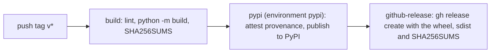

## Cut a release

1. Open a pull request that sets `"version"` in `package.json` to the new version and adds
   a `CHANGELOG.md` entry. Merge it.
2. Tag the merge commit on `main` and push the tag:

   ```bash
   git switch main && git pull
   git tag v<version>
   git push origin v<version>
   ```

3. `.github/workflows/release.yml` does the rest.

The tag must match the version: the workflow fails on `v1.2.0` if `package.json` says
`1.1.0`.

## What the release workflow does



| Job | Permissions | Publishes |
| --- | --- | --- |
| `build` | `contents: read` | nothing; uploads `dist/` as a workflow artifact |
| `pypi` | `id-token: write`, `attestations: write` | the wheel and sdist to PyPI, and a provenance attestation |
| `github-release` | `contents: write` | the GitHub release and its assets |

## Why no token is stored

- **PyPI** uses [trusted publishing](https://docs.pypi.org/trusted-publishers/): the `pypi`
  job asks GitHub for an OIDC token and PyPI exchanges it for a short-lived upload token.
  PyPI accepts it only for this repository's owner (pinned by its immutable
  `repository_owner_id`), this workflow file (`release.yml`) and the `pypi` environment.
- **GitHub releases** use the workflow's own `GITHUB_TOKEN`.

## Releases come from tags only

Three things keep a branch, a pull request or a fork from publishing:

1. The workflow triggers only on `push` of `v*` tags.
2. Every job runs only when `github.repository_id` is this repository's immutable id
   (`964113457`) and the ref is a `refs/tags/v*` tag. A repository recreated under the same
   name gets a new id and is refused.
3. The `pypi` environment allows deployments from `v*` tags only. PyPI cannot pin the
   repository id or the ref itself, so this protection rule is what holds the PyPI side to
   tags.

The docs deploy (`deploy-docs.yml`) assumes an AWS role whose trust policy pins the
repository's immutable OIDC subject,
`repo:vantagecompute@199674293/jupyterhub-theme@964113457:...`.

## One-time setup

These are repository and PyPI settings, done once by an administrator:

| Where | Setting |
| --- | --- |
| PyPI | A trusted publisher for `jh-vantage-theme`: owner `vantagecompute`, repository `jupyterhub-theme`, workflow `release.yml`, environment `pypi` (a pending publisher until the first upload) |
| GitHub, Settings > Environments | Environment `pypi`, deployment tags limited to `v*` |
| GitHub, Actions OIDC | `use_immutable_subject: true` for this repository |
| GitHub, Actions variables | `DOCS_BUCKET`, `DOCS_CF_DISTRIBUTION_ID`, `DOCS_SPOKE_ROLE_ARN` for the docs deploy |

## npm

The theme is not published to npm. JupyterLab loads it from the Python package, and
nothing at Vantage consumes it from npm.
